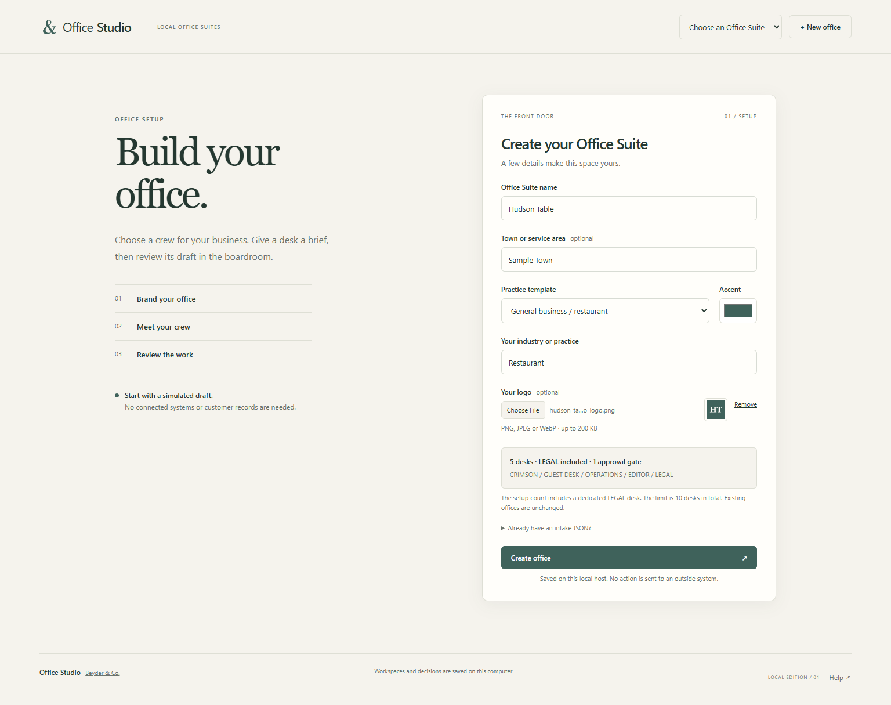
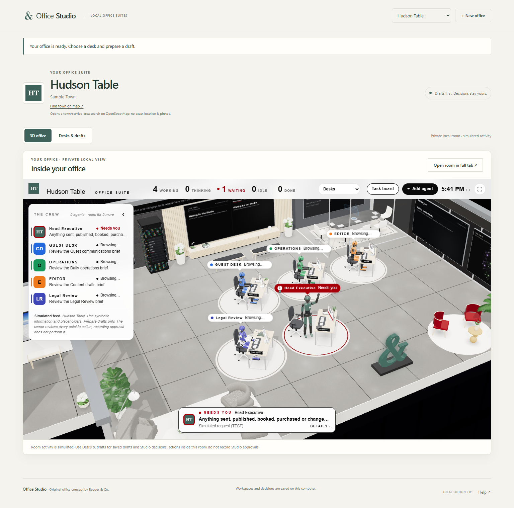
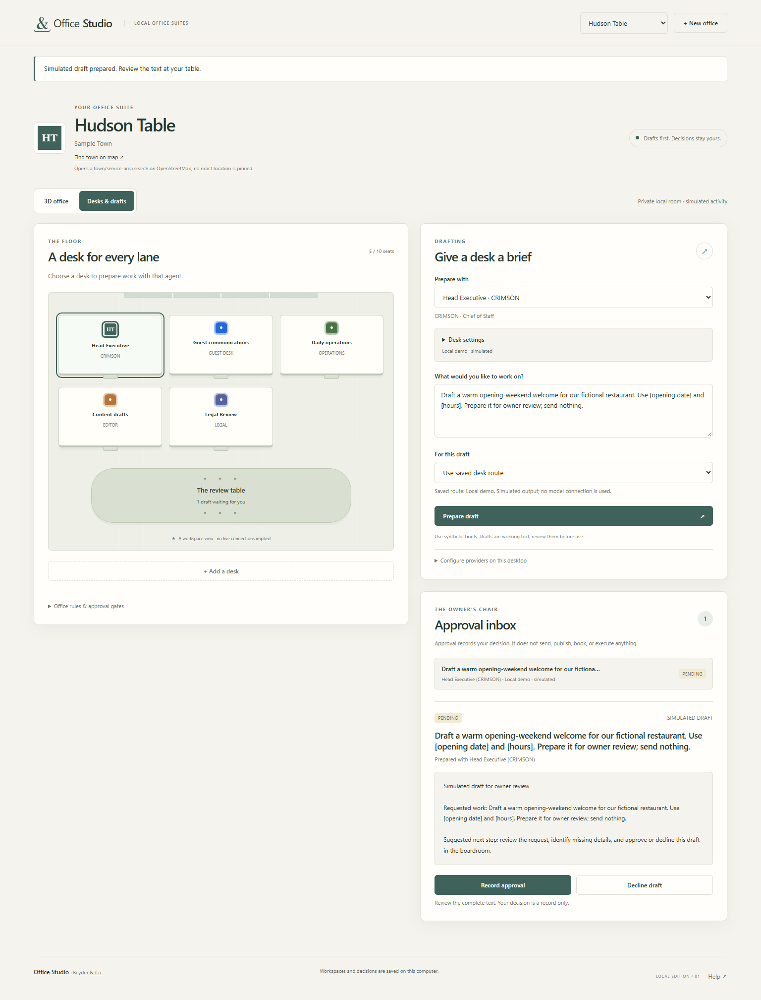

# Office Studio

Office Studio is a local web app for your business's crew. Give the Head Executive a brief for the morning meeting, or ask a specialist to draft a client update. Each desk can use a different model. The owner reviews the draft and records a decision in the boardroom.

The original 3D office and signature ampersand come from **Beyder & Co.** The mark uses the business's accent color. The sculpture glows red while the Head Executive has an alert and returns to the office color when that alert clears.

[Run the app](#start-locally) · [Set up a coding agent](#development)

### 1. Set up the office



### 2. Step inside the Office Suite



**Create office** opens the built-in tower in **Overview**. Choose **Desks** to see the crew seated inside. The company name, logo, colors, and crew come from the office you just created. Hudson Table is the fictional company in this walkthrough.

<details>
<summary>See the saved desks, drafts and approval inbox</summary>



</details>

The [Office Suite media kit](https://github.com/mragerlp/office-studio/tree/develop/media/instagram) includes the logo, Instagram artwork, and a short film of an office being created in the app.

## Start locally

**Using a packaged build:** Extract the complete ZIP for your operating system. Double-click **Start Office Studio.command** on an Apple Silicon Mac or **Start Office Studio.cmd** on Windows x64. The launcher starts the server and opens setup in your default browser. Keep its terminal window open while you work. The platform builds include their own runtime.

**Using source:** You need Python 3.10+ and a browser. The Python standard library serves the HTML, CSS, and JavaScript directly.

Run the command for your system from the extracted or cloned `office-studio` directory.

| Windows PowerShell   | macOS Terminal         |
| -------------------- | ---------------------- |
| `py -3 -B launch.py` | `python3 -B launch.py` |

The launcher prefers the [local address on port 8765](http://127.0.0.1:8765). It chooses a free port when needed and prints the actual address. Press **Ctrl+C** in the terminal to stop.

## Create → desk → draft → review

1. **Create an office.** Add a name, optional town/service area, accent color, and optional PNG/JPEG/WebP logo. Choose a practice template or enter your own industry, such as a restaurant.
   Select **Create office** to enter your company's 3D tower. Choose **Desks** to see the crew at their workstations.
2. **Choose a desk.** Each agent has a specialty and instructions. Every new office reserves one of its ten seats for **Legal Review**, which prepares questions and drafts for the owner or qualified counsel. Open **Desk settings** to change a display title, color, provider or model. The lead desk starts as **Head Executive** and uses your business accent and optional logo.
3. **Prepare a draft.** Write a synthetic brief. The desk uses its saved provider and model by default. Choose **Local demo · this draft only** to rehearse the workflow offline. The inbox records how each draft was generated.
4. **Review the text.** Approve or decline the draft in the inbox. The decision is saved locally. Sending a message or changing a business record remains a separate owner action.

Starter crews cover general business, real estate, law, accounting, financial advisory, medical administration, scientific research and biotechnology. You can also import an intake JSON pack. Templates supply crew, rules and approval gates. Use fictional information in sample packs.

The optional **Find town on map** link opens an OpenStreetMap search only when clicked. It does not establish an exact location or fetch a map during setup.

**Help** at the end of the page opens the [Beyder & Co. knowledge base](https://manual.beyderco.com/) when clicked. The [bundled app guide](help.html) is also available offline. Under **Office rules & approval gates**, save a company-specific HTTPS operating-manual link. It is available from the workspace header and from **The Field** in a compatible room. The app opens the manual on request. It does not crawl the site or give model providers its contents.

## Inside the 3D office

The source checkout and both platform packages include Igor Beyder's room and the Three.js renderer. Launch Office Studio and choose or create a workspace. The app serves the scene locally and populates it with that workspace's crew. A WebGL-capable browser is required for the 3D view.

Use **Overview** for the tower, **The Hudson** for the river, **Desks** to visit your crew, **Market Room** for the boardroom, and **Data Wall** for the displays. **The Door** takes you to the entrance. **Task board** shows the room's simulated activity. **Add agent** in the embedded room opens the saved workspace form. Use **Desks & drafts** to configure models, prepare a draft or record an owner decision.

To use another compatible room locally, place it beside the launcher as `private-room.html` or pass `--room-file`, then restart. The renderer runs on a separate loopback origin. [Three.js license](assets/three-LICENSE.txt)

## Storage and model providers

The server listens on loopback and saves offices, uploaded logos, drafts, and decisions in SQLite at `~/.office-studio/office.sqlite3` in your user home. Set `--data-dir` to choose another folder. All workspaces belong to the same local operator and depend on the host computer's access controls and disk protection.

New desks default to the offline demo. You can save a host-allowed model preference before adding an API key. If the provider is unavailable, live drafting stays disabled until it is configured or you explicitly select the demo.

To start a session with live providers, open **Configure Providers.command** on macOS or **Configure Providers.cmd** on Windows. Choose a provider, enter the model IDs available to your account, then enter its API key in the hidden terminal prompt. Repeat for another provider or press Enter to launch. These settings last for that server session. Alternatively, configure the following environment variables before launch.

| Provider | API key variable    | Default model            | Optional allowed models   |
| -------- | ------------------- | ------------------------ | ------------------------- |
| OpenAI   | `OPENAI_API_KEY`    | `OFFICE_OPENAI_MODEL`    | `OFFICE_OPENAI_MODELS`    |
| Claude   | `ANTHROPIC_API_KEY` | `OFFICE_ANTHROPIC_MODEL` | `OFFICE_ANTHROPIC_MODELS` |
| Gemini   | `GEMINI_API_KEY`    | `OFFICE_GEMINI_MODEL`    | `OFFICE_GEMINI_MODELS`    |
| Meta Muse | `MODEL_API_KEY` | `OFFICE_META_MODEL` | `OFFICE_META_MODELS` |

API keys stay in the server process. A live draft sends the brief, agent instructions, and workspace rules to the selected provider. A successful API response verifies access to that particular model. Consumer account sign-in and business system integrations remain future work.

Provider setup references are available from [OpenAI](https://developers.openai.com/api/docs/quickstart), [Anthropic](https://platform.claude.com/docs/en/api/overview), [Google](https://ai.google.dev/gemini-api/docs/api-key), and [Meta](https://dev.meta.ai/docs/overview).

## Check and package

Run the server and provider checks, then build the handoff package.

```powershell
# Windows
py -3 -B -m unittest -v
py -3 -B package.py
```

On macOS, use `python3` in place of `py -3`. Tests exercise the local HTTP API, restart persistence and model selection with synthetic data and mocked provider responses.

Packaging writes the source edition to `dist/office-studio.zip` from an explicit file list. It includes the 3D room, renderer, launchers, tests, walkthrough images and five packs. Use `--runner` for a platform executable. For a private handoff with a different room, use `--private-room`.

## Development

For your first contribution, start with the [shared agent guide](AGENTS.md). There are short entry guides for [Muse Code](MUSE.md), [Gemini CLI](GEMINI.md), [Claude Code](CLAUDE.md), and [Codex or ChatGPT](CODEX.md).

Daily work targets `develop`, the default branch. Open feature pull requests into `develop`. Promote a tested revision to `main` through a separate release pull request after owner review. The **Check Office Studio** workflow tests and builds a public platform ZIP on Windows and macOS. [View workflow runs](https://github.com/mragerlp/office-studio/actions/workflows/check.yml).

## Direction

The next spatial feature is a floor for each department. For example, an owner could enter the accounting floor, select a desk, and open its saved work. Department floors and placement at a verified geographic location are planned.

A future voice interface would let the owner brief the Head Executive. The current app accepts written briefs and saves per-desk model choices in **Desk settings**.

The ampersand artwork uses the Old Standard bold glyph from [the upstream typeface](https://github.com/google/fonts/tree/a01f27e9f42b5afad05090256d0d809928d84cae/ofl/oldstandardtt), matching the silhouette used for the room sculpture. The [font license](assets/OFL-Old-Standard.txt) accompanies the artwork.
