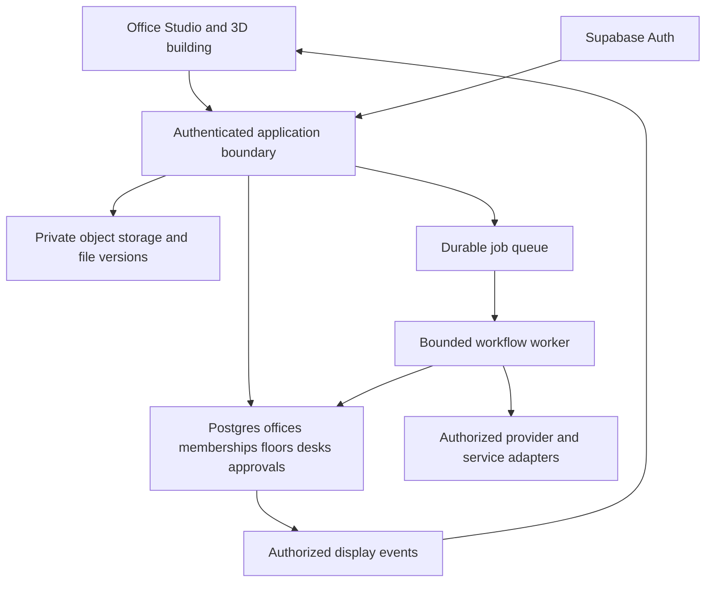

# Growing Office Studio into a business platform

Research checked November 3, 2026. Implementation baseline `9020047246ac1251e23faeb6a962593fcdf63a81`. These are proposed next steps for Jared and Igor, supported by the [source register](sources.md). They are not implemented features or capacity guarantees.

## Product direction

Keep the Office Suite as the business owner's front door. A person signs in, creates their business, connects a provider, gives a department work, and reviews the result. The skyscraper gives that work a place. Keep Igor's Hudson, bridge, exterior surroundings, and visual style. Expand the existing building downward with department floors and additional suites.

Recommend one first paid-pilot workflow: receive a selected customer inquiry, assign Intake, draft a response using the business's chosen connection, and have the owner review it. Measure whether the owner can complete that flow without Jared explaining each screen. Pricing and commercial positioning remain Igor's decisions.

## What we already have

The baseline has a local Python/SQLite edition and a separate hosted Supabase pilot. The hosted pilot documents Google/Microsoft identity, office membership checks, private text files, encrypted per-office provider keys, file-to-desk drafting, decisions, and a minimal display pack for the 3D room. Member invitations, mailbox integrations, customer billing, and provider-subscription sign-in remain future work. Local and hosted file limits and deletion behavior differ. See [hosted setup](../../../hosted/README.md) and [contributor rules](../../../AGENTS.md).

The renderer currently seats a small crew in one office. The ten-desk limit is enforced by application and database paths. Additional floors therefore need a data migration and a rendering design. Merely increasing a number will not provide reliable additional workstations or team permissions.

## Comparable systems and what to learn

| System | Evidence checked | Application to Office Studio |
| --- | --- | --- |
| StarNet | Pinned source has a provider factory/interface, separate account storage, budget helpers and a Claude CLI adapter | Reuse the architectural ideas of explicit routes, separate credentials, run receipts and bounded budgets. Keep Office Studio's business language and existing scenery. [Pinned source](sources.md#starnet) |
| LibreChat | Multiple model endpoints, file search with citations, agent sharing and access controls | Add clearly scoped business knowledge, a provider selector per desk, and permissions for who may use or edit a desk. File access must follow office membership. [Agent documentation](https://www.librechat.ai/docs/features/agents) |
| Dify | Workflow nodes can pause for a person's decision; model-provider setup is separately managed | Treat review as a persisted workflow step, and make connection setup understandable independently of the office scene. [Human Input](https://docs.dify.ai/en/cloud/use-dify/nodes/human-input), [providers](https://docs.dify.ai/en/cloud/use-dify/workspace/model-providers) |
| n8n | Queue mode separates the process receiving work from workers executing it | Dispatch work durably so a browser refresh does not lose a job. Adopt the pattern before considering an additional automation product. [Queue mode](https://docs.n8n.io/hosting/scaling/queue-mode/) |
| LangGraph | Checkpointers persist thread state for recovery and human review | Consider a workflow engine when multi-step delegation requires resumable state. Retain business permissions and approvals in Office Studio. [Persistence](https://docs.langchain.com/oss/python/langgraph/persistence) |
| LiteLLM | Virtual keys support controlled model access and budgets | Evaluate a gateway when operating many connections becomes expensive to maintain. The existing four adapters are enough for the first pilot. [Virtual keys](https://docs.litellm.ai/docs/proxy/virtual_keys) |

These are feature and architecture comparisons from documentation and selected source inspection. No competing application was runtime-tested during this research. Adopting dependency code requires a separate version, maintenance and license review.

## Three connection decisions the owner makes

1. **Sign in to Office Studio.** Use Supabase Auth with Google or Microsoft and an independent office membership model. Sign-in creates identity. It must not silently grant mailbox access.
2. **Connect business services.** Request Google Drive, Gmail, Outlook or calendar permissions when the person chooses that specific service. Display the account, mailbox, scope, last successful sync and Disconnect action.
3. **Connect a drafting provider.** Name the destination provider, permitted model, account scope and billing route. Distinguish configured credentials from a successful request and current model access.

Supabase does not automatically refresh Google/Microsoft provider access tokens. Background integrations need a secure server-side refresh lifecycle, revocation handling and reconnection experience. Office login sessions and external service tokens have separate lifecycles. [Supabase social sign-in](https://supabase.com/docs/guides/auth/social-sign-in)

### Provider feasibility as checked today

| Connector | Supported direction to investigate | Decision boundary |
| --- | --- | --- |
| ChatGPT / OpenAI | Existing API-key adapter for hosted drafting. Official Sign in with ChatGPT also documents eligible plan usage for open-source/local clients | Investigate the registered OAuth flow and verify scopes and inference completion. OpenAI directs paid or remotely hosted apps to its interest process. Office Studio has not been approved for that route. [Quickstart](https://developers.openai.com/siwc/quickstart), [open-source flow](https://developers.openai.com/siwc/token-sharing-open-source) |
| Claude | Business API key or supported inference cloud | Anthropic's documentation restricts third-party Claude.ai login and intermediation of consumer credentials. A separate unmodified-Claude-Code integration is a different product path and needs its own review. [Authentication rules](https://code.claude.com/docs/en/legal-and-compliance) |
| Gemini | API key, or an appropriately configured OAuth project | Google documents OAuth as an alternative to keys. Verify project quotas, billing and consent. A Google login or consumer subscription alone does not establish API entitlement. [OAuth](https://ai.google.dev/gemini-api/docs/oauth), [API keys](https://ai.google.dev/gemini-api/docs/api-key) |
| Meta Muse | Meta Model API bearer credential using the existing adapter boundary | Muse Code's browser sign-in is documented for its CLI. A comparable Office Studio web-account connection was not established by this research. [Meta overview](https://dev.meta.ai/docs/overview) |

Record models as provider IDs and capability metadata. A catalog entry is not proof that an account may run it. Test access through a deliberately authorized request. Keep credentials in server-side protected storage or the user's platform credential store. Keep portable project exports credential-free.

## Recommended hosted architecture

Use Supabase for identity, Postgres and private object storage. The current static hosted frontend can be delivered on Vercel or another HTTPS static host. Vercel is optional. Start background processing with a single durable queue and bounded workers. Supabase Queues fits the existing database stack. Vercel Workflows or LangGraph are alternatives to evaluate when resumable workflows grow complex. Select one execution system per workflow rather than layering several together. [Supabase Queues](https://supabase.com/docs/guides/queues), [Vercel Workflows](https://vercel.com/docs/workflows)

The server records job states such as queued, running, waiting for review, approved, completed, failed, cancelled and outcome unknown. Reserve estimated spend before dispatch, reconcile actual usage afterward, and expose unknown outcomes. Queue delivery guarantees cannot guarantee a third-party side effect or charge occurs exactly once. Separate retrying a safe fetch from retrying an ambiguous model charge or email send.

Bind approval to the exact output version, proposed action, destination and approver. Editing a draft invalidates its prior send approval. The current app's approval is a saved decision and download permission. Sending email would require a new, explicit action path and an external result receipt.

## Expanding the existing skyscraper

### Spatial and permission model

Proposed hierarchy: business organization → office building → floor → department suite → desk. Membership and roles govern the business data. A floor is a location and navigation choice. Visibility in a scene never grants access to a document.

Add stable building, floor and suite IDs with ordering, display name, layout version and desk placement. Keep existing desk IDs, business branding and provider routes. Migrate an existing office into its current top-floor suite. Keep its camera landmarks and view unchanged. Create lower-floor templates for Operations, Accounting, Finance and Legal as the business adds departments. Existing saved offices must continue to open without redoing setup.

Recommend one Head Executive per business office and one Legal Review desk per office at first. Moving Legal to another floor keeps its identity and queued work. Creating a floor should not silently duplicate those desks or launch additional paid workers.

### Scene implementation sequence

1. Introduce a floor selector and one additional empty lower suite. Keep the original environment and exterior in one shared scene, with separate groups for interior floor geometry.
2. Display the selected floor in detail. Hide or simplify other interiors. Use shared geometry/materials and bounded pixel ratio/shadows. Suspend rendering when hidden or idle where feasible. Avoid one WebGL renderer per floor.
3. Add a desk to the chosen suite with a visible placement preview, capacity check and undo. Preserve the camera and renderer when seating it, following the existing hosted Add desk regression fix.
4. Persist layouts with a version. Concurrent edits need a revision check and a conflict message. An undo of placement must not undo a completed business action.
5. Update task-board views by building, floor and suite. Both header and room ampersands derive from authorized pending executive work across the office. Resolve an alert only when all relevant pending items clear.

Render work status from persisted run events. Keep simulated activity labelled. The display frame receives a minimal presentation projection and permitted navigation events. File text, provider credentials and account tokens stay in the authenticated application boundary.

Suggested performance acceptance for a first prototype, to be measured: three floors with ten desks each, one detailed floor visible, keyboard floor switching, and a usable text task-board fallback on a low-powered Mac. Measure frame time, memory and switch latency before raising limits further. This is a proposed test target, not a measured result.

## Feature order and release gates

| Slice | Owner-visible result | Required demonstration before release |
| --- | --- | --- |
| Mac rehearsal | Current ZIP launches and renders correctly | Verify the exact private ZIP, Finder launch, actual Gatekeeper behavior, 3D scene, dark selector, alerts and approval after restart |
| Accounts and teams | Owner invites a colleague and controls office access | Invite/revoke, expired sessions, forbidden cross-office rows/files, owner transfer and last-owner protection with two fictional businesses |
| Connections | Each desk has an explicit provider and each service has a separate grant | Connect, successful authorized request, revoke, refresh expiry, inaccessible model and unavailable provider, with no silent provider switch |
| Persistent work | Work survives refresh and worker interruption | Duplicate submission/webhook tests, cancellation, worker restart, review resumption and ambiguous provider outcome handling |
| One useful business flow | A selected inquiry becomes a reviewed reply | Jared can demonstrate the end-to-end flow and a new owner completes it with the help page |
| Building expansion | Additional department floors have persistent desks | Old-office migration, stable desk IDs, placement undo, conflict handling, permission checks and measured rendering performance |
| Customer operations | Predictable support, storage and spend | Budget/concurrency enforcement, restore drill, export/deletion, billing sandbox webhooks and incident diagnostics |

Do the Mac rehearsal on the existing reviewed release first. Research does not change the sealed ZIPs or claim a new release has passed that rehearsal.

## Email, knowledge and customer operations

Start mail with selected messages or a deliberately connected test mailbox. Gmail scopes have distinct sensitivity levels and restricted server-side data access can require verification and a security assessment. Microsoft Graph separates read/write mail from send permission and requires subscription renewal for change notifications. Build explicit consent, refresh/revoke handling, incremental synchronization and webhook deduplication. [Gmail scopes](https://developers.google.com/workspace/gmail/api/auth/scopes), [Graph permissions](https://learn.microsoft.com/en-us/graph/permissions-reference), [Graph subscriptions](https://learn.microsoft.com/en-us/graph/api/resources/subscription?view=graph-rest-1.0)

For business knowledge, distinguish the product's Help from the company's operating manual. Add selected documents with source/version citations, access filters and removal behavior. PDFs and spreadsheets need extraction limits and sandboxed processing before wider support. Treat retrieved pages, files and email as untrusted inputs. Content inside them must not authorize a connection, select another tenant, expand tool access or approve an action.

Add billing only after the workflow is reliable. Stripe subscription events can drive plan entitlements, with verified webhook signatures, event deduplication and server-side reconciliation. Plan access and model usage budgets are separate controls. [Subscription events](https://docs.stripe.com/billing/subscriptions/webhooks), [webhook handling](https://docs.stripe.com/webhooks)

Plan backups for database rows and uploaded objects independently. Supabase database backups exclude Storage object contents. Test restoring both and retaining matching file versions. Add content-redacted run diagnostics, office-level rate and spend controls, queue depth, latency/error dashboards and an owner-visible activity log. [Backups](https://supabase.com/docs/guides/platform/backups), [Storage authorization](https://supabase.com/docs/guides/storage/security/access-control)

For the first load exercise, propose ten synthetic businesses and fifty queued jobs, with strict per-office fairness, mocked providers, worker crashes and attempted cross-office access. Establish latency and cost baselines before agreeing larger customer capacity. There is no production scale proof from this research.

## Igor's next decisions

- Confirm the first customer workflow and whether the next usable pilot is local, hosted or both.
- Choose the first two department floors and whether shared business members need office-wide or suite-specific access.
- Decide whether to pursue OpenAI's eligible open-source sign-in route, its paid/hosted program, or API keys for the initial hosted pilot.
- Set the first pilot's usage caps, support process and retention expectations.

The proposed next implementation is team membership plus one resumable, owner-reviewed inquiry workflow. Prototype the lower floor behind a feature switch using fictional businesses, then connect its desks to those same persistent tasks.
