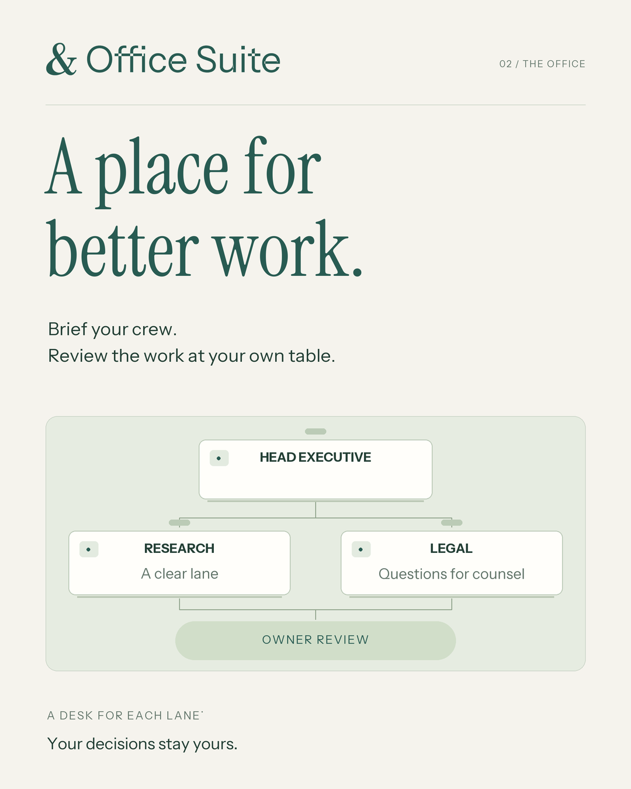

# Office Suite media kit

Office Suite is the workspace you create in Office Studio. Start with the [vertical reel](create-office-reel.mp4) for a walkthrough, or pick a still below for a post.

The 31-second reel follows a fictional business through setup and the **Desks & drafts** workspace. It plays silently with on-screen captions. Hudson Table chooses its branding and template, creates a five-desk crew, prepares a local draft, and records its approval. See the [built-in 3D office in the project walkthrough](https://github.com/mragerlp/office-studio/tree/develop#2-step-inside-the-office-suite).

| Use | File | Size |
| --- | --- | --- |
| Square feed post | [PNG](office-suite-post-square.png) | 1080 × 1080 |
| Portrait feed post | [PNG](office-suite-feed-portrait.png) | 1080 × 1350 |
| Full-screen Story | [PNG](office-suite-story.png) | 1080 × 1920 |
| Profile picture | [Ampersand avatar](office-suite-avatar.png) | 1080 × 1080 |
| Logo on a light background | [Vector](office-suite-wordmark.svg) · [Transparent PNG](office-suite-wordmark.png) | Scalable · 2048 × 360 |
| Reel | [MP4](create-office-reel.mp4) | 1080 × 1920 |
| Widescreen presentation for a meeting | [MP4](create-office-presentation.mp4) | 1920 × 1080 |

## Caption

Build your office. Pick a template, choose your colors, and meet your crew. Watch Hudson Table give a desk its first brief, then take the draft to the boardroom for a decision.

Office Suite by Office Studio. Original office concept and signature ampersand by Beyder & Co.

## Alt text for the posts

- **Square:** “Every desk. Its own model.” Research, Editor, and Legal desks use separate model choices and send their drafts to owner review.
- **Portrait:** “A place for better work.” A floor plan connects the Head Executive with Research and Legal, then brings the work to the owner.
- **Story:** “Brief the crew. Review the work. Make the call.” Cream lettering on pine green sits above a diagram ending with the choice to approve or decline.

The vector logo has outlined lettering and can be resized without installing a font. Font credits and licenses are included for [Old Standard](OFL-Old-Standard.txt), [Instrument Sans](OFL-Instrument-Sans.txt), and [Instrument Serif](OFL-Instrument-Serif.txt).
